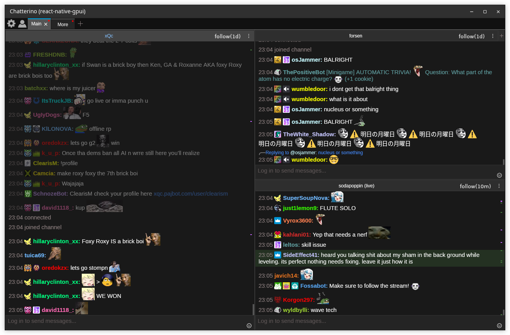
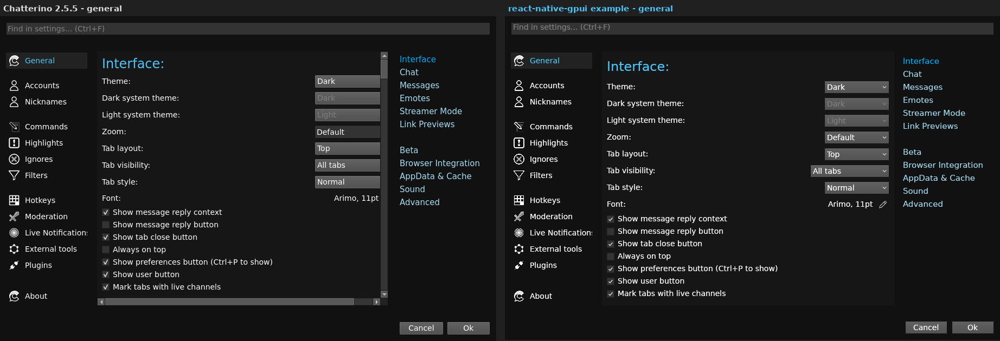
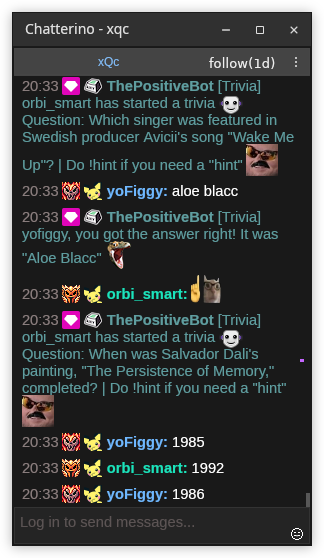

# chatterino-gpui

[](https://github.com/felipe-software/react-native-gpui) [](https://chatterino.com) [](#requirements)

A Twitch chat client that looks and behaves like [Chatterino 2](https://chatterino.com) (2.5.5),
written in React with [react-native-gpui](https://github.com/felipe-software/react-native-gpui).
There is no browser or Electron: GPUI, Zed's GPU UI framework, draws the React tree natively on
Vulkan (Linux) or Metal (macOS).

> Not an official Chatterino project. It reuses Chatterino's MIT-licensed icons, sounds and
> contributor list; see [License](#license).



The chat log is the library's native `ChatList` element. Tabs, the split grid, headers, inputs,
popups and dialogs are React components in `src/ui`, and the data (IRC, history, emotes, badges,
highlights, accounts, settings, layout) comes from `createChatCore()` in `src/data`.

## Requirements

- [Bun](https://bun.sh) 1.4 or newer, which installs the dependencies, bundles the app and runs
  the tests.
- Node.js 18 or newer for the package scripts.
- A platform react-native-gpui ships a prebuilt renderer for:

| Platform | Also needs |
| --- | --- |
| Linux x64 or arm64 (glibc), Wayland or X11 | a Vulkan driver (Mesa or your GPU vendor's) and WebKitGTK's JavaScriptCore: `libjavascriptcoregtk-4.1-0` on Debian and Ubuntu, `javascriptcoregtk4.1` on Fedora (the `-6.0` and `-4.0` builds work too) |
| macOS on Apple Silicon | nothing else |

Anywhere else (an Intel Mac, for example), build `rngpui-service` from the library's source and
point `RNGPUI_SERVICE` at it.

## Install

```sh
git clone https://github.com/felipe-software/chatterino-gpui.git
cd chatterino-gpui
bun install
```

`bun install` also picks the renderer package for your platform
(`@felipe-software/react-native-gpui-linux-x64`, `-linux-arm64` or `-darwin-arm64`).

### Using an unreleased build of the library

`scripts/use-local-gpui.mjs` installs the library from `.tgz` files instead of npm, for example
to try a library change before it is released. It only writes `node_modules`: `package.json` and
`bun.lock` keep pointing at npm, so no local path ends up in a commit.

```sh
# in a react-native-gpui checkout: build the library and pack it
cd react-native-gpui/ts
npm run build
npm run npm:pack -- --out /tmp/rngpui-packs

# back in chatterino-gpui
bun scripts/use-local-gpui.mjs /tmp/rngpui-packs
```

It installs the newest `@felipe-software/react-native-gpui` tarball in that folder and the
renderer tarball of the same version for your platform. `bun install` goes back to the npm release.

## Run

```sh
bun run start        # bundle src/main.tsx into .build/chatterino.js and open the window
bun run start:dev    # the same with a development bundle
bun run bundle       # only write .build/chatterino.js
```

`scripts/run.mjs` bundles with the library's bundler (`rngpui bundle`) and starts the
`rngpui-service` binary the library resolves: `RNGPUI_SERVICE` when it is set, otherwise the
installed renderer package.

Settings, accounts and the tab layout are saved in
`~/.local/share/com.chatterino.gpui/local-storage.json` on Linux and
`~/Library/Application Support/com.chatterino.gpui/local-storage.json` on macOS.

| Variable | Effect |
| --- | --- |
| `RNGPUI_SERVICE` | run this `rngpui-service`, for example `rust/target/release/rngpui-service` from a library checkout |
| `RNGPUI_APP_ID` | app id, which also names the data and cache folders (default `com.chatterino.gpui`) |
| `RNGPUI_STORAGE_DIR`, `RNGPUI_CACHE_DIR` | keep `localStorage` or the HTTP cache in another folder, for a throwaway profile |
| `CHATTERINO_TIMING=1` | logs `[chatterino-timing] {event, t}` lines: join, ivr lookup, `ROOMSTATE`, each emote set and its source, history fetched / prepended / rebuilt |
| `CHATTERINO_IRC_URL` | IRC WebSocket URL instead of `wss://irc-ws.chat.twitch.tv:443` |
| `CHATTERINO_RECENT_MESSAGES_URL` | recent-messages URL template, `%1` is the channel (the same format as Chatterino's `CHATTERINO2_RECENT_MESSAGES_URL`) |

The library's own variables are listed in
[its README](https://github.com/felipe-software/react-native-gpui/tree/main/ts#readme).

### Inspect and drive it

The library's `rngpui` CLI launches the bundle offscreen, captures it and drives it:

```sh
bun run bundle
bun run rngpui shot --bundle .build/chatterino.js --size 1280x800 --keep   # prints a session dir
bun run rngpui do tap settings-button --session <dir>
bun run rngpui reshot --session <dir>
bun run rngpui close --session <dir>
```

Real keystrokes, clicks and drags go through the control socket (`realKey`, `realtap`, `realdown`,
`realmove`, `realup`, `realcontext`, `realscroll`). `globalThis.__chatterinoDebug()` returns the
app services (core, layout actions, overlays, hit areas) for `evalJs` probes.

## Test

```sh
bun test             # data and UI unit tests
bun run typecheck
```

CI (`.github/workflows/test.yaml`) runs both on every push and pull request to `main`.

## Comparison with Chatterino

The settings next to Chatterino 2.5.5's (Chatterino on the left):



Popups and dialogs are real windows, as in Chatterino. A split in its own window (Ctrl+N):



`docs/compare/` runs the installed Chatterino 2.5.5 (Flatpak) with the same layout, theme and
font, so screenshots of both apps line up.

### What is implemented

| Area | Behavior |
| --- | --- |
| Window | Settings (gear) and account buttons, tabs with close button, live dot, unread (`#888` line) and highlighted (red line) states, `+` add tab, 2 px divider, Chatterino's colors for all four themes; Chatterino's button effect (hover glow at the pointer, click ripple) on tabs, corner, header and input buttons |
| Tabs | Select, add, close (asks first), rename (double-click or menu), reorder by dragging, duplicate, close multiple, unread marking toggle, lock layout, sort, tab visibility (all / live / none, Ctrl+U) |
| Split grid | The `SplitNode` tree from `core.layout` with Chatterino's layout math (48 px minimum before scaling, 1 px borders, last child to the far edge), new splits on the far right, resize handles (thin hover band, all handles while Ctrl is held, double-click or right-click resets), drag a header onto a split's edge zones, container edge strips with `+` markers, a tab (append) or `+` (new tab), focus moves with Alt+arrows, layout saved through `core.layout`; Ctrl+Alt overlay (move, left/right/up/down with half previews, clickable `+` strips) |
| Split | Header with title, ` (live)` plus the optional uptime/viewers/game/title parts, Chatterino's live tooltip (title, 160x90 thumbnail, game, "Live for ... with ... viewers") or offline tooltip, room modes, moderation-mode button for mods, kebab menu in Chatterino's order (popup, search, browser, reconnect, More: moderation mode, subscribe, notify when live, mute sounds, clear), `+` on the top-right split; chat in `ChatList` with settings and theme colors; reply buttons (`showReplyButton`); message context menu (image Open/Copy submenus, link items, copy message/full message, reply/thread items, Moderate, Twitch channel link items, Shift: message ID/JSON); username right-click mention or reply (Shift); middle click opens the web viewer card or the link; emote and badge tooltips at the cursor; "More messages below"; "Paused" indicator |
| Input | Placeholder per login state, Enter sends, Ctrl+Enter keeps the text, Shift+Enter inserts a line break, grows to several lines up to 150 px (250 px with a reply), characters past 500 drawn red, Up/Down history, Tab/Shift+Tab completion at the cursor, `:` and `@` completion popup (Up/Down, Tab/Enter, Esc), reply mode ("Replying to @name" bar with the replied text and cancel, `@name` prefix, sends with `reply-parent-msg-id`), emote button, optional length counter |
| Popups | User card, emote popup (opens on Subs at the top, centered sections per provider, search that hides the tabs, Ctrl+1..9/Ctrl+Tab/Ctrl+F), reply-thread popup (root and replies, live, subscribe checkbox, replies to the root), split popup window (Ctrl+N), quick switcher (Ctrl+K), search popup, channel dialog (special channels enabled when `core` provides them), settings, add-account dialog, menus, tooltips |
| Hotkeys | Ctrl+P, Ctrl+T, Ctrl+W, Ctrl+R, Ctrl+G, Ctrl+N, Ctrl+K, Ctrl+1..9, Ctrl+Tab, Ctrl+Shift+Tab, Ctrl+Shift+T, Ctrl+Shift+W, Ctrl+U, Ctrl+F, Ctrl+Shift+F, Ctrl+E, Ctrl+F5, Ctrl+End, Ctrl++ / Ctrl+- / Ctrl+0 and Ctrl+wheel (zoom: chat font and emotes, ±0.1 in 0.2..10), Alt+arrows, Esc |

### Known differences

- The user card, emote popup, search popup, reply-thread popup, split popups and every dialog
  (settings, add account, select channel, rename, confirm) are real windows opened with
  `<Window>` (`src/ui/overlays/overlayWindows.ts` maps each overlay to a window kind). Menus,
  tooltips and the quick switcher stay inside the main window. Wayland does not let apps place
  windows, so there the compositor picks the position of the user card and the others.
  Overlay windows and streamlink are not available.
- No window activation signal yet, so the focused split's header keeps its focused colors when
  the window is inactive.
- Resize handles also appear when hovering a split border (Chatterino needs Ctrl); Ctrl shows all.
- Modifier state only reaches JS with mouse events, so the Ctrl+Alt overlay, the Ctrl resize
  handles and the Ctrl+wheel zoom catcher appear on the first mouse move after the keys go
  down and stay until the next move after they are released.
- Middle click works only inside the chat: views get no middle-button events, so it does
  nothing on tabs and headers, and middle-click autoscroll is missing (no scroll API).
- The input never reports its caret, so completion at the cursor follows the caret from edits
  and arrow keys, and setting the text moves the caret to the end.
- Zoom scales the chat font and emotes; tabs, headers and other chrome keep their size.
- The emote popup has one Emojis section (no categories in the emoji data) and Twitch
  subscriber emotes are grouped as `Twitch`.
- Ctrl+Shift+N, F5, Alt+X, PgUp/PgDown, Ctrl+Home, Ctrl+H, F10 and Ctrl+Alt+N are not bound.
- Whispers, Watching, Live and AutoMod stay disabled in the channel dialog until `core`
  provides those channels.
- Block in the user card ignores the user locally; it does not call Twitch's block API.

### Emote loading

Emotes come up as fast as the network allows, and a relaunch shows them with the history:

- **Images** load over HTTP/2 and land in the library's HTTP disk cache
  (`~/.cache/com.chatterino.gpui/http` on Linux, `~/Library/Caches/com.chatterino.gpui/http` on
  macOS), so a relaunch reads them from disk. The emote CDNs are preconnected at startup
  (`ImageCache.preconnect`).
- **Room ids** come from ivr.fi as soon as a channel is joined, in parallel with IRC, and are kept
  in `localStorage` (`chatterino-gpui/v1/room-ids`), so the next launch starts the channel's emote
  sets right away instead of waiting for `ROOMSTATE`.
- **Emote sets and badges** (BTTV, FFZ, 7TV channel and global sets, ivr.fi badges, Chatterino and
  BTTV user badges) are read from the disk cache first (`fetch(url, { cache: "only-if-cached" })`)
  and refreshed from the network at the same time (`cache: "reload"`), see `requestCachedJson` in
  `src/data/util/http.ts`. A refresh with an identical body is ignored.
- **History** is shown as soon as it arrives. It waits at most 500 ms, and only for the cached
  sets. When a set arrives later, the history is rebuilt from its IRC lines and only messages
  whose output changed are patched in, so words turn into emotes in place.
- **Prefetch**: the images of the last 20 history messages are handed to `ImageCache.prefetch`
  before the history is appended, so the first paint usually finds them downloaded and decoded.

#### Timing emotes against Chatterino

`scripts/emote-timing.mjs` (Bun, Linux) launches this app headless and the Flatpak Chatterino
2.5.5 on a private Xvfb, one run per channel, cold (empty caches) and then warm (second launch).
It needs the Flatpak (`flatpak install --user flathub com.chatterino.chatterino`), `Xvfb`, `xwd`
and `ffmpeg`, and runs our app in a private headless compositor named `rngpui-headless-0`
(`RNGPUI_TIMING_WAYLAND_DISPLAY` picks another one):

```sh
dbus-run-session -- mutter --headless --wayland --no-x11 --wayland-display=rngpui-headless-0 \
    --virtual-monitor 1920x1080 &
env -u DISPLAY bun scripts/emote-timing.mjs                       # xqc, forsen, sodapoppin, both apps
env -u DISPLAY bun scripts/emote-timing.mjs --layout main --repeat 2
env -u DISPLAY bun scripts/emote-timing.mjs --apps baseline,ours,chatterino \
    --baseline-service /tmp/old/rngpui-service --baseline-bundle /tmp/old/chatterino.js --repeat 2
```

- **History is replayed**: each channel's recent messages are recorded once into
  `<work>/history` and served to both apps (`CHATTERINO2_RECENT_MESSAGES_URL` /
  `CHATTERINO_RECENT_MESSAGES_URL`), so both show the same first screen and runs compare.
  `--history live` asks robotty instead, `--record` records again.
- **Live chat is dropped** by default: `scripts/irc-quiet-proxy.mjs` forwards real Twitch IRC
  (so `JOIN` and `ROOMSTATE` keep their real timing) but drops `PRIVMSG`, `USERNOTICE`,
  `CLEARCHAT` and `CLEARMSG`, so the first screen is exactly the tail of the history.
  `--mode live` connects directly.
- **Our app** is measured from spawn through the debug socket: `chatListState` with
  `images: true` every 25 ms, then `timings: true` for each image's requested, settled and
  first-painted time. "First screen" is the messages visible when history first appears,
  followed by id until the end of the run, so emotes added by a later rebuild count.
- **Chatterino** is measured from the `chatterino` process start (`/proc/<pid>/stat`) with
  `QT_LOGGING_RULES=chatterino.http.debug=true`: history is the "Successfully loaded recent
  messages" line, emotes are `Get 200` / `Get [CACHED] 200` lines for emote CDN URLs. It only
  loads images for visible messages, so its first screen is the burst of emote loads after the
  history (until a 2 s gap). `xwd` frames of `:98` land in the profile's `frames-<state>/` as PNGs
  with a colorful-pixel series (`colorful.json`) as a visual cross-check.
- **Order**: with `--repeat 2` the app order flips each round, since whichever app asks first
  warms the CDN edge for the other. `cdn.7tv.app` is about 280 ms away from roberto and serves
  slowly and unevenly (12 small images: 1.9-9 s between back-to-back runs), so cold runs with
  many 7TV emotes vary a lot.

Measured on roberto on 2026-11-08 (medians of 2 runs, replayed history, live chat dropped, seconds
from process start; "before" is the build before the HTTP/2 client, disk cache and data changes):

| Channel | Start | History shown before / now / Chatterino | All first-screen emotes painted before / now / Chatterino |
| --- | --- | --- | --- |
| xqc | cold | 1.76 / 0.30 / 1.57 | 2.02 (4) / 5.83 (7; the 4 non-7TV at 0.31) / 1.80 (4) |
| xqc | warm | 2.69 / 0.32 / 1.47 | 2.85 (4) / 0.32 (7) / 3.34 (12) |
| forsen | cold | 2.40 / 0.28 / 1.54 | 2.68 (7) / 0.57 (8) / 1.80 (3) |
| forsen | warm | 1.63 / 0.28 / 1.36 | 2.05 (7) / 0.29 (8) / 1.59 (8) |
| sodapoppin | cold | 1.92 / 0.26 / 1.48 | 3.13 (1) / 11.80 (8, 7 of them 7TV) / 1.64 (3) |
| sodapoppin | warm | 2.03 / 0.31 / 1.88 | 3.08 (1) / 0.31 (7) / 6.83 (14) |

Numbers in parentheses are the emotes on that first screen. On a cold start Chatterino and the
old build both build the history before the channel's 7TV set arrives (about 3.2 s from 7tv.io),
so those words stay text; this app turns them into emotes when the set arrives, and then waits on
the 7TV CDN. With the real history service (`--history live --mode live`), history and the first
emote showed at about 1.9 s cold here, against 3.6-3.9 s for Chatterino, which asks for history
only after `ROOMSTATE`.

## Project layout

| Path | Contents |
| --- | --- |
| `src/main.tsx` | Entry point: renders `App` in a 1280 x 800 window |
| `src/data/` | Chat core: IRC, history, emotes, badges, highlights, filters, commands, accounts, settings and layout persistence, with tests |
| `src/ui/` | The React UI, see below |
| `assets/` | Chatterino 2.5.5 settings icons, button images, sounds, avatars and contributor list |
| `scripts/` | `run.mjs` (bundle and launch), `gpui.mjs` (finds the library's bundler and binary), `use-local-gpui.mjs`, `emote-timing.mjs` and `irc-quiet-proxy.mjs`, `gen-data.mjs` (regenerates the emoji and TLD tables), `smoke-data.mjs` (joins live channels and prints what the data layer built) |
| `docs/` | The side-by-side setup files in `compare/` and the README screenshots |

| `src/ui` folder | Contents |
| --- | --- |
| `layout/` | Pure split tree, geometry and tab operations with unit tests |
| `input/` | Pure completion, caret, reply and send-history logic with tests |
| `state/` | App context, layout actions, overlays, UI-only preferences, registries for inputs and hit areas |
| `window/` | Main window and tab bar |
| `splits/` | Tab page, split, header, chat view, input, resize handle, drop overlay |
| `overlays/` | Menus, tooltip and every popup or dialog |
| `settings/` | Settings pages |
| `common/` | Shared widgets (buttons, button effect, fields, checkbox, window frame, chat feed) |
| `assets/` | Chatterino 2.5.5 button icons used by the UI |

## License

MIT, see [LICENSE](LICENSE).

The files in `assets/` and the button icons in `src/ui/assets/` come from Chatterino 2.5.5 and are
used under Chatterino's MIT license: see [assets/CHATTERINO-LICENSE.txt](assets/CHATTERINO-LICENSE.txt).
