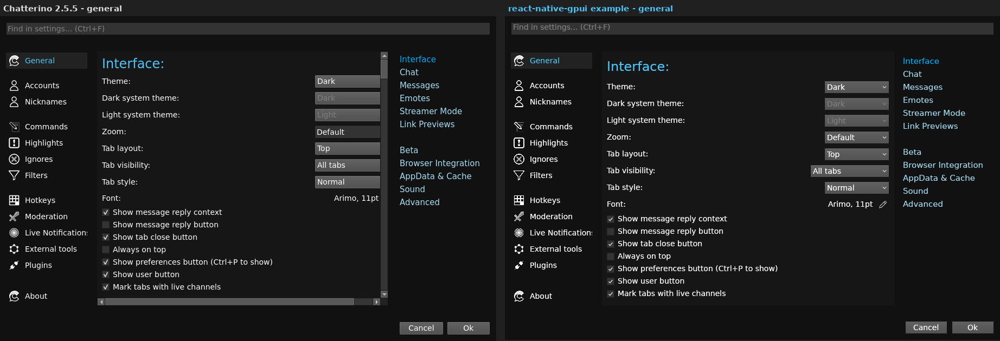
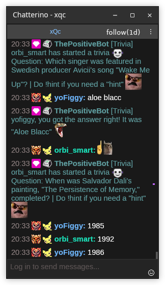

# Development

## Using an unreleased build of the library

`scripts/use-local-gpui.mjs` installs the library from `.tgz` files instead of npm, for example
to try a library change before it is released. It only writes `node_modules`: `package.json` and
`bun.lock` keep pointing at npm, so no local path ends up in a commit.

```sh
# in a react-native-gpui checkout: build the library and pack it
cd react-native-gpui/ts
npm run build
npm run npm:pack -- --out /tmp/rngpui-packs

# back in chatterino-gpui
bun scripts/use-local-gpui.mjs /tmp/rngpui-packs
```

It installs the newest `@felipe-software/react-native-gpui` tarball in that folder and the
renderer tarball of the same version for your platform. `bun install` goes back to the npm release.

## Data and environment

Settings, accounts and the tab layout are saved in
`~/.local/share/com.chatterino.gpui/local-storage.json` on Linux and
`~/Library/Application Support/com.chatterino.gpui/local-storage.json` on macOS.

| Variable | Effect |
| --- | --- |
| `RNGPUI_SERVICE` | run this service binary instead of `native/target/release/chatterino-gpui-service` |
| `RNGPUI_APP_ID` | app id, which also names the data and cache folders (default `com.chatterino.gpui`) |
| `RNGPUI_STORAGE_DIR`, `RNGPUI_CACHE_DIR` | keep `localStorage` or the HTTP cache in another folder, for a throwaway profile |
| `CHATTERINO_TIMING=1` | logs `[chatterino-timing] {event, t}` lines: join, ivr lookup, `ROOMSTATE`, each emote set and its source, history fetched / prepended / rebuilt |
| `CHATTERINO_IRC_URL` | IRC WebSocket URL instead of `wss://irc-ws.chat.twitch.tv:443` |
| `CHATTERINO_RECENT_MESSAGES_URL` | recent-messages URL template, `%1` is the channel (the same format as Chatterino's `CHATTERINO2_RECENT_MESSAGES_URL`) |

The library's own variables are listed in
[its README](https://github.com/felipe-software/react-native-gpui/tree/main/ts#readme).

## Inspect and drive it

The library's `rngpui` CLI launches the bundle offscreen, captures it and drives it. Point it at
this app's service binary, which has the chat list:

```sh
bun run bundle
export RNGPUI_SERVICE=native/target/release/chatterino-gpui-service
bun run rngpui shot --bundle .build/chatterino.js --size 1280x800 --keep   # prints a session dir
bun run rngpui do tap settings-button --session <dir>
bun run rngpui reshot --session <dir>
bun run rngpui close --session <dir>
```

Real keystrokes, clicks and drags go through the control socket (`realKey`, `realtap`, `realdown`,
`realmove`, `realup`, `realcontext`, `realscroll`). `globalThis.__chatterinoDebug()` returns the
app services (core, layout actions, overlays, hit areas) for `evalJs` probes.

## Native chat list

The chat log is one native element drawn by this app's own service binary: the Rust code is
in `native/src/chat_list/` (`model` parsing, `layout` per-message layout, `state`
buffer/scroll/selection, `element` the GPUI element, `images` loading and animation clock,
`events`, `debug` dump and tap), registered through react-native-gpui's `NativeElement`
extension point in `native/src/main.rs`. `native/` is a Cargo workspace that depends on the
library crate in `../react-native-gpui/rust` and repeats its `[patch.crates-io]` entries. The
React side is `src/native/chatList/`: `ChatList.tsx` (the component and its handle),
`chatListHost.ts` (the host declared with `defineNativeComponent`) and `types.ts`.
`bun run build:native` builds `native/target/release/chatterino-gpui-service` and stages the
library's `ui-runtime.js` beside it; `bun run start` and the scripts launch it.

Messages never travel as props: the ref's methods stream them into the native element, so
an append costs only the new messages. The element keeps up to `maxMessages` (default 1000,
oldest dropped), lays out and paints only visible rows, and caches each message's layout
until its width, font, scale or content changes.

- Message flags: `disabled` and `historical` fade a message, `hidden` takes it out of the
  layout until a patch sets it back, `background` fills the row, `marker` colors its
  scrollbar tick. A badge's `background` paints behind its image (FFZ's custom moderator
  badge).
- Handle: `append`, `prepend` (history, oldest first), `update` (patches by `id`; pass `""`
  to clear a string or color field), `clear`, `scrollToBottom`, `scrollToTop`,
  `scrollToMessage(id, { align: "top" | "center" | "bottom" })` (default center), `pageUp`,
  `pageDown` (one viewport).
- Elements are separated by one space; whitespace inside a text element separates words.
  `trailingSpace: false` glues the next element to it (`@alice` + `,`).
- Layout follows Chatterino: 8/4 px margins, elements bottom-aligned per line, emotes count
  as 4 px shorter than they are (they overhang 2 px above and below), badges are not scaled
  by `emoteScale`, zero-width emotes are centered over the previous emote, and a `reply`
  renders as one truncated line at 0.8x size with a curve.
- Scrolling: wheel/trackpad and a thin scrollbar that widens on hover and shows `marker`
  colors. At the bottom the list follows new messages; scrolled up, appends, prepends and
  trimming keep the rows you are reading in place, and `onScrollState` reports
  `{ atBottom, paused, unseen }`. `pauseOnHover` freezes the view while the pointer is over
  the list.
- Interaction: `onHover` fires with the user, link, emote or badge under the pointer, its
  window-space bounds and the pointer position, or `null` when it leaves. `onPress` fires for
  user/link/emote/badge, or `message` for anything else, with the button, pointer position
  and modifier keys. Left clicks fire on release unless the pointer moved more than 15 px;
  right and middle clicks fire on press.
- Selection: drag selects across messages, double-click a word, triple-click the message
  body. Ctrl+C copies it, including while a `TextInput` is focused, unless that input holds a
  newer selection of its own. Emotes copy as their names, badges copy nothing.

Implementation notes:

- **Scroll position is a message anchor, not a pixel offset**: `(seq, px into that message)`.
  Appends get increasing seqs and prepends decreasing ones, so the deque stays contiguous and
  `index = seq - front.seq`. That is why append, prepend and trimming do not move a
  scrolled-up view, and why the scrollbar counts messages (Chatterino's thumb math:
  `y = rel/n·(h−11)+1`, `height = page/n·(h−11)+10`).
- **Commands and events** go through the library's generic wire: `nativeCommand` with
  `type: "chatlist"` (parsed on the tree-parser thread, applied on the main thread, which arms
  a paint-only frame), and events `chatListPress`, `chatListHover`, `chatListScroll`. Options
  are paint-only for the retained-layout gate.
- **Paint inside `window.paint_layer`.** GPUI inserts every primitive painted outside a layer
  into the scene's BoundsTree. Three layers per list (content, zero-width overlays, selection
  and scrollbar) cut paint from 3.3 ms to about 1 ms per frame for ~7k glyphs. Inside one layer
  sprites sort by atlas tile id, not insertion order, which is why zero-width emotes get their
  own layer.
- **Never call `pointer_reaches` during prepaint.** Spans painted later are not registered
  yet and its per-position memo caches the wrong answer for the rest of the frame. The list
  records `pointer_inside` from its mouse handlers and reads that in prepaint.
- **Animation**: images load with `cx.fetch_asset::<ImgResourceLoader>` (shared with
  `<Image>` and `ImageCache.prefetch`), and a load completion arms a paint-only refresh. Frame
  index comes from one global epoch (all copies in sync, delays of 10 ms or less play as
  100 ms, minimum 20 ms). Only painted emotes compute a deadline and one timer serves the
  earliest, so a visible 200 ms GIF repaints at 5 fps and a list with no visible animation
  never repaints.
- **Copy is routed at the root frame**, not by focusing the list: the library asks every
  native element for its selection (`selected_text`, `selection_changed_at`), so the chat
  selection wins unless the focused `TextInput` holds a newer one.
- **Debugging**: `rngpui get tree` shows one synthetic node per visible message
  (`chatlist-message`, `nativeID` = message id) with children
  `chatlist-user|text|link|emote|badge|timestamp|reply-curve`; the `chatlist` node carries a
  `nativeState` summary (counts, scroll state, selection, image and wake counters). `do tap`
  runs the list's own hit test, so it agrees with `realtap`. The debug socket answers
  `chatListState` (`images: true` adds the visible images and their state, `timings: true` each
  image's requested, settled and first-painted time).

Gates, all with the app binary (`bun run build:native` first):

```sh
bun run conformance:chat-list          # wrapping, emotes, pixels, GIF cadence, events, selection, copy, anchoring, scrollbar
bun run conformance:chat-list-window   # a ChatList in a second <Window>: commands, hover, press, close drops its state
bun run perf:chat-list                 # 6 lists x 1000 messages at 20 messages/s: main-thread CPU and frames/s
cd native && cargo test                # parsing, words, selection and anchoring unit tests
```

`perf:chat-list` takes `--seconds`, `--warmup`, `--max-main-cpu` and `--json`, and the fixture
reads `CHAT_STRESS_LISTS`, `CHAT_STRESS_PREFILL`, `CHAT_STRESS_RATE`,
`CHAT_STRESS_ANIMATED_EVERY` and `CHAT_STRESS_ANIMATE=0`. Fixtures are in `scripts/fixtures/`.

## Comparison with Chatterino

The settings next to Chatterino 2.5.5's (Chatterino on the left):



Popups and dialogs are real windows, as in Chatterino. A split in its own window (Ctrl+N):



`docs/compare/` runs the installed Chatterino 2.5.5 (Flatpak) with the same layout, theme and
font, so screenshots of both apps line up.

### What is implemented

| Area | Behavior |
| --- | --- |
| Window | Settings (gear) and account buttons, tabs with close button, live dot, unread (`#888` line) and highlighted (red line) states, `+` add tab, 2 px divider, Chatterino's colors for all four themes; Chatterino's button effect (hover glow at the pointer, click ripple) on tabs, corner, header and input buttons |
| Tabs | Select, add, close (asks first), rename (double-click or menu), reorder by dragging, duplicate, close multiple, unread marking toggle, lock layout, sort, tab visibility (all / live / none, Ctrl+U) |
| Split grid | The `SplitNode` tree from `core.layout` with Chatterino's layout math (48 px minimum before scaling, 1 px borders, last child to the far edge), new splits on the far right, resize handles (thin hover band, all handles while Ctrl is held, double-click or right-click resets), drag a header onto a split's edge zones, container edge strips with `+` markers, a tab (append) or `+` (new tab), focus moves with Alt+arrows, layout saved through `core.layout`; Ctrl+Alt overlay (move, left/right/up/down with half previews, clickable `+` strips) |
| Split | Header with title, ` (live)` plus the optional uptime/viewers/game/title parts, Chatterino's live tooltip (title, 160x90 thumbnail, game, "Live for ... with ... viewers") or offline tooltip, room modes, moderation-mode button for mods, kebab menu in Chatterino's order (popup, search, browser, reconnect, More: moderation mode, subscribe, notify when live, mute sounds, clear), `+` on the top-right split; chat in `ChatList` with settings and theme colors; reply buttons (`showReplyButton`); message context menu (image Open/Copy submenus, link items, copy message/full message, reply/thread items, Moderate, Twitch channel link items, Shift: message ID/JSON); username right-click mention or reply (Shift); middle click opens the web viewer card or the link; emote and badge tooltips at the cursor; "More messages below"; "Paused" indicator |
| Input | Placeholder per login state, Enter sends, Ctrl+Enter keeps the text, Shift+Enter inserts a line break, grows to several lines up to 150 px (250 px with a reply), characters past 500 drawn red, Up/Down history, Tab/Shift+Tab completion at the cursor, `:` and `@` completion popup (Up/Down, Tab/Enter, Esc), reply mode ("Replying to @name" bar with the replied text and cancel, `@name` prefix, sends with `reply-parent-msg-id`), emote button, optional length counter |
| Popups | User card, emote popup (opens on Subs at the top, centered sections per provider, search that hides the tabs, Ctrl+1..9/Ctrl+Tab/Ctrl+F), reply-thread popup (root and replies, live, subscribe checkbox, replies to the root), split popup window (Ctrl+N), quick switcher (Ctrl+K), search popup, channel dialog (special channels enabled when `core` provides them), settings, add-account dialog, menus, tooltips |
| Hotkeys | Ctrl+P, Ctrl+T, Ctrl+W, Ctrl+R, Ctrl+G, Ctrl+N, Ctrl+K, Ctrl+1..9, Ctrl+Tab, Ctrl+Shift+Tab, Ctrl+Shift+T, Ctrl+Shift+W, Ctrl+U, Ctrl+F, Ctrl+Shift+F, Ctrl+E, Ctrl+F5, Ctrl+End, Ctrl++ / Ctrl+- / Ctrl+0 and Ctrl+wheel (zoom: chat font and emotes, ±0.1 in 0.2..10), Alt+arrows, Esc |

### Known differences

- The user card, emote popup, search popup, reply-thread popup, split popups and every dialog
  (settings, add account, select channel, rename, confirm) are real windows opened with
  `<Window>` (`src/ui/overlays/overlayWindows.ts` maps each overlay to a window kind). Menus,
  tooltips and the quick switcher stay inside the main window. Wayland does not let apps place
  windows, so there the compositor picks the position of the user card and the others.
  Overlay windows and streamlink are not available.
- No window activation signal yet, so the focused split's header keeps its focused colors when
  the window is inactive.
- Resize handles also appear when hovering a split border (Chatterino needs Ctrl); Ctrl shows all.
- Modifier state only reaches JS with mouse events, so the Ctrl+Alt overlay, the Ctrl resize
  handles and the Ctrl+wheel zoom catcher appear on the first mouse move after the keys go
  down and stay until the next move after they are released.
- Middle click works only inside the chat: views get no middle-button events, so it does
  nothing on tabs and headers, and middle-click autoscroll is missing (no scroll API).
- The input never reports its caret, so completion at the cursor follows the caret from edits
  and arrow keys, and setting the text moves the caret to the end.
- Zoom scales the chat font and emotes; tabs, headers and other chrome keep their size.
- The emote popup has one Emojis section (no categories in the emoji data) and Twitch
  subscriber emotes are grouped as `Twitch`.
- Ctrl+Shift+N, F5, Alt+X, PgUp/PgDown, Ctrl+Home, Ctrl+H, F10 and Ctrl+Alt+N are not bound.
- Whispers, Watching, Live and AutoMod stay disabled in the channel dialog until `core`
  provides those channels.
- Block in the user card ignores the user locally; it does not call Twitch's block API.

### Emote loading

Emotes come up as fast as the network allows, and a relaunch shows them with the history:

- **Images** load over HTTP/2 and land in the library's HTTP disk cache
  (`~/.cache/com.chatterino.gpui/http` on Linux, `~/Library/Caches/com.chatterino.gpui/http` on
  macOS), so a relaunch reads them from disk. The emote CDNs are preconnected at startup
  (`ImageCache.preconnect`).
- **Room ids** come from ivr.fi as soon as a channel is joined, in parallel with IRC, and are kept
  in `localStorage` (`chatterino-gpui/v1/room-ids`), so the next launch starts the channel's emote
  sets right away instead of waiting for `ROOMSTATE`.
- **Emote sets and badges** (BTTV, FFZ, 7TV channel and global sets, ivr.fi badges, Chatterino and
  BTTV user badges) are read from the disk cache first (`fetch(url, { cache: "only-if-cached" })`)
  and refreshed from the network at the same time (`cache: "reload"`), see `requestCachedJson` in
  `src/data/util/http.ts`. A refresh with an identical body is ignored.
- **History** is shown as soon as it arrives. It waits at most 500 ms, and only for the cached
  sets. When a set arrives later, the history is rebuilt from its IRC lines and only messages
  whose output changed are patched in, so words turn into emotes in place.
- **Prefetch**: the images of the last 20 history messages are handed to `ImageCache.prefetch`
  before the history is appended, so the first paint usually finds them downloaded and decoded.

#### Timing emotes against Chatterino

`scripts/emote-timing.mjs` (Bun, Linux) launches this app headless and the Flatpak Chatterino
2.5.5 on a private Xvfb, one run per channel, cold (empty caches) and then warm (second launch).
It needs the Flatpak (`flatpak install --user flathub com.chatterino.chatterino`), `Xvfb`, `xwd`
and `ffmpeg`, and runs our app in a private headless compositor named `rngpui-headless-0`
(`RNGPUI_TIMING_WAYLAND_DISPLAY` picks another one):

```sh
dbus-run-session -- mutter --headless --wayland --no-x11 --wayland-display=rngpui-headless-0 \
    --virtual-monitor 1920x1080 &
env -u DISPLAY bun scripts/emote-timing.mjs                       # xqc, forsen, sodapoppin, both apps
env -u DISPLAY bun scripts/emote-timing.mjs --layout main --repeat 2
env -u DISPLAY bun scripts/emote-timing.mjs --apps baseline,ours,chatterino \
    --baseline-service /tmp/old/rngpui-service --baseline-bundle /tmp/old/chatterino.js --repeat 2
```

- **History is replayed**: each channel's recent messages are recorded once into
  `<work>/history` and served to both apps (`CHATTERINO2_RECENT_MESSAGES_URL` /
  `CHATTERINO_RECENT_MESSAGES_URL`), so both show the same first screen and runs compare.
  `--history live` asks robotty instead, `--record` records again.
- **Live chat is dropped** by default: `scripts/irc-quiet-proxy.mjs` forwards real Twitch IRC
  (so `JOIN` and `ROOMSTATE` keep their real timing) but drops `PRIVMSG`, `USERNOTICE`,
  `CLEARCHAT` and `CLEARMSG`, so the first screen is exactly the tail of the history.
  `--mode live` connects directly.
- **Our app** is measured from spawn through the debug socket: `chatListState` with
  `images: true` every 25 ms, then `timings: true` for each image's requested, settled and
  first-painted time. "First screen" is the messages visible when history first appears,
  followed by id until the end of the run, so emotes added by a later rebuild count.
- **Chatterino** is measured from the `chatterino` process start (`/proc/<pid>/stat`) with
  `QT_LOGGING_RULES=chatterino.http.debug=true`: history is the "Successfully loaded recent
  messages" line, emotes are `Get 200` / `Get [CACHED] 200` lines for emote CDN URLs. It only
  loads images for visible messages, so its first screen is the burst of emote loads after the
  history (until a 2 s gap). `xwd` frames of `:98` land in the profile's `frames-<state>/` as PNGs
  with a colorful-pixel series (`colorful.json`) as a visual cross-check.
- **Order**: with `--repeat 2` the app order flips each round, since whichever app asks first
  warms the CDN edge for the other. `cdn.7tv.app` is about 280 ms away from roberto and serves
  slowly and unevenly (12 small images: 1.9-9 s between back-to-back runs), so cold runs with
  many 7TV emotes vary a lot.

Measured on roberto on 2026-11-08 (medians of 2 runs, replayed history, live chat dropped, seconds
from process start; "before" is the build before the HTTP/2 client, disk cache and data changes):

| Channel | Start | History shown before / now / Chatterino | All first-screen emotes painted before / now / Chatterino |
| --- | --- | --- | --- |
| xqc | cold | 1.76 / 0.30 / 1.57 | 2.02 (4) / 5.83 (7; the 4 non-7TV at 0.31) / 1.80 (4) |
| xqc | warm | 2.69 / 0.32 / 1.47 | 2.85 (4) / 0.32 (7) / 3.34 (12) |
| forsen | cold | 2.40 / 0.28 / 1.54 | 2.68 (7) / 0.57 (8) / 1.80 (3) |
| forsen | warm | 1.63 / 0.28 / 1.36 | 2.05 (7) / 0.29 (8) / 1.59 (8) |
| sodapoppin | cold | 1.92 / 0.26 / 1.48 | 3.13 (1) / 11.80 (8, 7 of them 7TV) / 1.64 (3) |
| sodapoppin | warm | 2.03 / 0.31 / 1.88 | 3.08 (1) / 0.31 (7) / 6.83 (14) |

Numbers in parentheses are the emotes on that first screen. On a cold start Chatterino and the
old build both build the history before the channel's 7TV set arrives (about 3.2 s from 7tv.io),
so those words stay text; this app turns them into emotes when the set arrives, and then waits on
the 7TV CDN. With the real history service (`--history live --mode live`), history and the first
emote showed at about 1.9 s cold here, against 3.6-3.9 s for Chatterino, which asks for history
only after `ROOMSTATE`.

## Project layout

| Path | Contents |
| --- | --- |
| `src/main.tsx` | Entry point: renders `App` in a 1280 x 800 window |
| `src/data/` | Chat core: IRC, history, emotes, badges, highlights, filters, commands, accounts, settings and layout persistence, with tests |
| `src/native/chatList/` | The `ChatList` component, its native host declaration and message types |
| `native/` | Rust workspace for this app's service binary: the native chat list registered on react-native-gpui |
| `src/ui/` | The React UI, see below |
| `assets/` | Chatterino 2.5.5 settings icons, button images, sounds, avatars and contributor list |
| `scripts/` | `run.mjs` (bundle and launch), `gpui.mjs` (finds the library's bundler and this app's binary), `build-native.mjs`, the chat-list conformance and stress scripts with their `fixtures/`, `use-local-gpui.mjs`, `emote-timing.mjs` and `irc-quiet-proxy.mjs`, `gen-data.mjs` (regenerates the emoji and TLD tables), `smoke-data.mjs` (joins live channels and prints what the data layer built) |
| `docs/` | The side-by-side setup files in `compare/` and the README screenshots |

| `src/ui` folder | Contents |
| --- | --- |
| `layout/` | Pure split tree, geometry and tab operations with unit tests |
| `input/` | Pure completion, caret, reply and send-history logic with tests |
| `state/` | App context, layout actions, overlays, UI-only preferences, registries for inputs and hit areas |
| `window/` | Main window and tab bar |
| `splits/` | Tab page, split, header, chat view, input, resize handle, drop overlay |
| `overlays/` | Menus, tooltip and every popup or dialog |
| `settings/` | Settings pages |
| `common/` | Shared widgets (buttons, button effect, fields, checkbox, window frame, chat feed) |
| `assets/` | Chatterino 2.5.5 button icons used by the UI |
